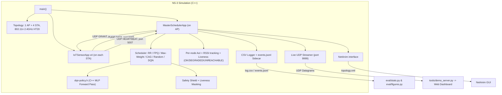

# AoI DRL Scheduler — NS-3 Simulation

A review-ready NS-3 simulation of the 1-AP + 4-STA testbed: a centralized
grant-reply scheduling protocol running as an application-layer overlay on
802.11n, identical in structure to the real ESP32 + Raspberry Pi firmware
(see [`common/contracts/packets.py`](../common/contracts/packets.py)).
It compares five baseline schedulers under a deterministic AoI safety
shield and produces the plots used in the panel demo.

This simulation evaluates both the five heuristic baseline schedulers and the
frozen **Deep Q-Network (DQN)** policy evaluated natively in C++ via
[`dqn-policy.h`](dqn-policy.h) (without ns3-ai or Python runtime overhead),
under realistic 802.11n MAC/PHY conditions with a deterministic safety shield.

## Prerequisites

- A Linux environment (Ubuntu 22.04 or 24.04, native dual-boot, WSL2, or Docker).
- ~4 GB free disk space for NS-3 + NetAnim.
- Python 3.11+ with `pandas`, `matplotlib`, `numpy`, `scipy`, `pyyaml`, and `pytest`.

## Quick Start

```bash
# 1. Install NS-3.41 and symlink this directory into its scratch/ folder
bash ns3-sim/scripts/ns3_setup.sh

# 2. Run C++ / NumPy parity gate test (works on Linux and Windows)
pytest tests/test_ns3_policy_parity.py -v

# 3. Single DQN evaluation run
cd ~/ns3/ns-allinone-3.41/ns-3.41
./ns3 run "scratch/aoi-scheduler/aoi-scheduler-sim \
    --scheduler=dqn \
    --policyFile=deploy/artifacts/dqn_seed0.txt \
    --policyId=dqn_seed0 \
    --seed=100 \
    --csvOutput=ns3-sim/results/S0/dqn_seed0/seed100/log.csv"

# 4. Full S0-S4 comparison campaign (parallel across cores)
bash ns3-sim/scripts/run_campaign.sh

# 5. Run the Realtime Live Demo + Web Dashboard
bash tools/run_live_demo.sh
```

## Architecture



## Node Configuration

| Node  | Class     | Weight | Distance | Shield ceiling |
|-------|-----------|--------|----------|-----------------|
| STA-1 | Urgent    | 10     | 5 m      | 2.0 s |
| STA-2 | Urgent    | 10     | 8 m      | 2.0 s |
| STA-3 | Important | 3      | 12 m     | 6.0 s |
| STA-4 | Routine   | 1      | 18 m     | 20.0 s |

These match `config/system.yaml`'s `system.node_classes`,
`scheduler.weights`, and `scheduler.shield_ceilings_s` exactly.

## Scheduler Algorithms

All schedulers are wrapped by the deterministic safety shield and liveness masking:

- **Round Robin**: `a_t = t mod 4` (skipping unreachable nodes).
- **Fixed Priority**: highest class (urgent > important > routine), ties broken by AoI.
- **Max-Weight**: `argmax_i w_i * AoI_i` over reachable nodes.
- **Channel-Aware Greedy**: `argmax_i w_i * AoI_i * p_success(RSSI_i)` (logistic delivery probability).
- **Random**: uniform selection among reachable nodes.
- **Deep Q-Network (DQN)**: 16→64→64→4 MLP running natively in C++ via `dqn-policy.h`, with `ActMasked` reachability masking.

## Parameters & CLI Flags

| CLI flag | Meaning | Default | Maps to blueprint |
|---|---|---|---|
| `--scheduler` | `rr\|fpq\|maxweight\|cag\|random\|dqn` | `rr` | N2.1 |
| `--policyFile` | Path to plain-text exported weights | `""` | N1.1, N2.1 |
| `--policyId` | Identifier string for CSV column | `""` | N2.1 |
| `--slotDuration` | Slot duration in seconds | `0.1` (100 ms) | `system.slot_duration_ms` |
| `--simTime` | Simulation duration in seconds | `300.0` | `scheduler.run_duration_s` |
| `--seed` | RNG replication seed (`SetRun`) | `100` | `rl.eval_seeds` |
| `--txPower` | Transmit power in dBm | `20.0` | `sim/channel.py` (N2.2) |
| `--pathLossExp` | Log-distance path loss exponent | `2.8` | N2.2 |
| `--distanceScale` | Node distance scaling factor | `1.0` | N2.2 |
| `--interferer` | `none\|cochannel\|hidden` | `none` | S2 scenario (N2.4) |
| `--mobileNode` | Node ID for waypoint mobility | `-1` | S3 scenario (N2.4) |
| `--failNode` | Node ID for fault injection | `-1` | S4 scenario (N2.4) |
| `--scenarioFile` | JSON timeline scenario file | `""` | `demo.json` (N2.4) |
| `--liveUdpPort` | UDP port for live telemetry streaming | `0` (disabled) | N2.6 |
| `--realtime` | Enable wall-clock simulation clock | `false` | N2.6 |

## Output Files

Colocated with `--csvOutput`:

- **`log.csv`** — per-slot telemetry matching `SLOT_LOG_COLUMNS`.
- **`events.jsonl`** — timestamped event stream (faults, recoveries, shield activations, interferer).
- **`flowmon-results.xml`** — NS-3 FlowMonitor packet and delay metrics.
- **`topology.xml`** — NetAnim animation trace.

## Analysis Scripts

Run from the project root so `common.contracts` resolves:

```bash
python ns3-sim/analysis/plot_aoi_sawtooth.py ns3-sim/results/cag_seed0.csv
python ns3-sim/analysis/plot_scheduler_comparison.py ns3-sim/results/
python ns3-sim/analysis/generate_flowmon_plots.py ns3-sim/results/flowmon-results.xml
python ns3-sim/analysis/validate_against_contracts.py ns3-sim/results/rr_seed0.csv
```

## Contract Validation

`validate_against_contracts.py` is the bridge that proves the C++
simulation and the Python codebase agree on the math:

1. Checks the CSV's column order against `SLOT_LOG_COLUMNS`.
2. Independently replays every node's AoI trace using
   `common.contracts.aoi.update_aoi_for_slot` and diffs it against what
   NS-3 logged (tolerance well under one slot's floating-point noise).
3. Prints `common.contracts.state_spec.get_state_schema_hash()` for
   provenance.

## Troubleshooting

- **`./ns3 configure` fails on Qt/NetAnim deps** — install
  `qtbase5-dev qtchooser qt5-qmake qtbase5-dev-tools`; NetAnim itself
  builds separately with `qmake NetAnim.pro && make`.
- **`import common.contracts...` fails in the analysis scripts** — run
  them from the project root, or note that
  `validate_against_contracts.py` inserts the project root onto
  `sys.path` itself (two directories up from `ns3-sim/analysis/`).
- **CSV file fails to open (`NS_ASSERT_MSG`)** — the simulation does not
  create output directories; `mkdir -p` the `--csvOutput` parent first
  (both `ns3_setup.sh`'s verification step and `run_all_schedulers.sh`
  already do this for `ns3-sim/results/`).
